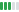

# vallmon - VALL drawdown switch monitor

Tracks **VALL** - the Vanguard FTSE Global All-Cap UCITS ETF USD Acc (London
Stock Exchange: `VALL.L`, ISIN `IE000VAHT5T0`) - and answers one question: in a
drawdown, should spending come from cash or from the fund?

It is a two-threshold switch whose state is recorded alongside every reading.
The Rolling Variance Delta and the volatility term structure are reported as
context: they describe dispersion, not direction, and never change the switch.
[How the numbers work →](docs/methodology.md)

_Updated automatically each trading day by the GitHub Actions workflow._
_Read the published HTML version at <https://ruicsh.github.io/projects/vallmon>._

<!-- REPORT:START -->
_As of 2026-11-12 · 39 readings · 2026-09-21 → 2026-11-12_

## State

**Equity** — drawdown -2.56%, unchanged for 39 readings (since 2026-09-21).

No action. Switch to cash at -15% — a further 12.4 pp.

> Window: 39 of 756 readings. The peak is not yet a 756-day peak, so signals are provisional until ~2029-09-16.

## Signal history

_No state changes yet — the switch has been in **equity** since the first reading._

## Drawdown

| Metric | Value |
|--------|-------|
| Peak (trailing 756d) | 3.7925 (2026-10-06) |
| Current drawdown | -2.56% |
| Distance to switch | 12.4 pp |
| History seen | 39 of 756 readings |

_Rule: switch to cash at or below -15% of the trailing peak; return to equity at or above -5%._

## Volatility context

| Metric | Value |
|--------|-------|
| Δσ | 1.44  |
| Current σ (W=20, ann.) | 15.54% |
| Baseline μ (N≤90) | 10.79% |
| Term slope σ10/σ30 | 1.48 (backwardated) |
| Latest volume | 7,226,517 units |
| Δσ min / max / median | 0.81 / 1.48 / 1.01 |

**Δσ trend** `▄▃▃▃▃▃▂▂▂▃▃▃▃▃▃▂▂▂▂▂▁▁▁▁▁▁▂▂▂▃▃▃▃▆▆▆▆▇▇` 1.10 → 1.44 (range 0.81–1.48, 39 readings)

**Term structure** (σ ann.): 10d 20.44% · 20d 15.54% · 30d 13.77% · 60d —

_Volatility labels are sticky: a band must hold for 3 readings before the label changes._

## Recent readings

| Date | Close (GBP) | Day % | Drawdown | State | Signal | Δσ | Volatility |
|------|------------:|------:|---------:|-------|--------|----:|------------|
| 2026-11-12 | 3.696 | +0.30%  | -2.56% | equity | hold | 1.44 |  |
| 2026-11-11 | 3.684 | +1.70%  | -2.85% | equity | hold | 1.48 |  |
| 2026-11-10 | 3.623 | +0.29%  | -4.47% | equity | hold | 1.36 |  |
| 2026-11-09 | 3.612 | +1.18%  | -4.75% | equity | hold | 1.36 |  |
| 2026-11-06 | 3.571 | +0.17%  | -5.85% | equity | hold | 1.29 |  |
| 2026-11-05 | 3.564 | -2.40%  | -6.01% | equity | hold | 1.32 |  |
| 2026-11-04 | 3.652 | +0.86%  | -3.70% | equity | hold | 1.06 |  |
| 2026-11-03 | 3.621 | -0.81%  | -4.52% | equity | hold | 1.01 |  |
| 2026-11-02 | 3.651 | +0.62%  | -3.74% | equity | hold | 1.01 |  |
| 2026-10-30 | 3.628 | -1.68%  | -4.34% | equity | hold | 1.01 |  |
| 2026-10-29 | 3.690 | -0.49%  | -2.70% | equity | hold | 0.93 |  |
| 2026-10-28 | 3.708 | +0.15%  | -2.23% | equity | hold | 0.94 |  |
| 2026-10-27 | 3.703 | +0.90%  | -2.37% | equity | hold | 0.94 |  |
| 2026-10-26 | 3.670 | +0.47%  | -3.24% | equity | hold | 0.87 |  |
| 2026-10-23 | 3.652 | -0.07%  | -3.69% | equity | hold | 0.87 |  |
| 2026-10-22 | 3.655 | -1.18%  | -3.63% | equity | hold | 0.90 |  |
| 2026-10-21 | 3.699 | +0.31%  | -2.48% | equity | hold | 0.83 |  |
| 2026-10-20 | 3.687 | -0.46%  | -2.78% | equity | hold | 0.81 |  |
| 2026-10-19 | 3.704 | +0.14%  | -2.33% | equity | hold | 0.83 |  |
| 2026-10-16 | 3.699 | -0.54%  | -2.47% | equity | hold | 0.95 |  |

_Last 20 of 39 readings. Full series: [data/delta_sigma.csv](data/delta_sigma.csv)._

_How these are computed: [docs/methodology.md](docs/methodology.md)._
<!-- REPORT:END -->

## Legend

### Reading columns

What each column in the readings table above means.

| Column | Values | In plain words |
|--------|--------|----------------|
| Date | a trading day | The London session the row describes. Weekends and holidays are absent; a bar taken before the 16:30 close is picked up the next day. |
| Close (GBP) | a price | What one VALL unit cost at that day's London close, in pounds. |
| Day % | `+x.xx%` ▲ / `-x.xx%` ▼ | The move since the previous reading. ▲ means up and ▼ means down; the sign carries the meaning, so the arrow is decoration, not a signal. |
| Drawdown | `0.00%` to `-100%` | How far below its highest close of the past ~3 years the price sits. `0.00%` is a fresh high; `-15%` is where spending switches to cash. |
| State | `equity` / `cash` | Which asset to spend from: `equity` sells from the fund, `cash` spends the cash bucket. |
| Signal | `hold` / `draw from cash` / `refill` | What changed at this reading: `hold` = nothing, `draw from cash` = just switched into cash, `refill` = just switched back to equity. |
| Δσ | a ratio centred on 1 | The last 20 days' volatility divided by its 90-day baseline. `1.00` = as calm as usual; above = bigger daily moves, below = smaller. |
| Volatility | a bar | Δσ as a five-step bar. The key below explains the steps; it describes the size of moves, never their direction. |

### Volatility bars

Δσ against its 90-day baseline. Three bars is normal; more means bigger day-to-day moves.

| Bars                                                                                 | Meaning     | In plain words                                                                                                                    |
| ------------------------------------------------------------------------------------ | ----------- | --------------------------------------------------------------------------------------------------------------------------------- |
|    | compressed  | Unusually still. The market is barely twitching day to day. Peaceful — though sometimes the quiet before a storm.                 |
|  | compressing | Calming down. Quieter than it was a few weeks ago.                                                                                |
|            | normal      | Ordinary. The usual amount of daily movement.                                                                                     |
|      | expanding   | Getting jumpier. Daily swings are growing — something is stirring.                                                                |
|        | elevated    | Unusually turbulent. Big daily swings. Usually a stressful period, but also the time you'd want to be buying rather than selling. |

## Setup

### Local

```bash
python3 -m venv .venv && source .venv/bin/activate
pip install -r requirements.txt

python vallmon.py run             # fetch + append + print the latest reading
python vallmon.py run --strict    # ...but refuse to append if stored rows drifted
python vallmon.py rebuild         # recompute the whole series from source (overwrites CSV)
python vallmon.py history         # recent readings with a trend sparkline
python vallmon.py drawdown        # drawdown from the trailing peak + switch state
python vallmon.py backtest VT     # replay the switch over a long history (read-only)
python vallmon.py report          # regenerate the findings section above
python portfolio_report.py build --report /tmp/PORTFOLIO.md  # build the portfolio input
python publish_site.py --target ../ruicsh.github.io \
    --portfolio /tmp/PORTFOLIO.md                            # publish the HTML site
```

### Portfolio report

`portfolio_report.py` builds a full stock-level view of VALL: every equity
line, its latest one-day move, and its ICB sector and market-cap band. The
report is an input to the site publisher, not a committed artifact — the
`publish-site` workflow writes it to `$RUNNER_TEMP` and only the rendered site
is published. The builder:

- re-fetches Vanguard's complete holdings file on every run, so additions and
  removals are picked up automatically;
- resolves tickers to Yahoo symbols and caches them in
  `data/portfolio_symbols.json` (keyed by SEDOL, so a returning line keeps its
  old mapping);
- caches Hong Kong issuer-country lookups in
  `data/portfolio_hk_countries.json`;
- compares the current holdings with `data/portfolio_holdings.json` and prints
  an **Holdings changes** section in the report.

The first run does the name searches and profile lookups; later runs only
refresh holdings and quotes, resolving new lines as they appear. Use
`--refresh-symbols` to rebuild the symbol and country maps, or `--no-search`
to skip Yahoo name search when offline.

### Published site

`publish_site.py` renders the drawdown monitor and the portfolio report into
one HTML page at <https://ruicsh.github.io/projects/vallmon>. It writes the
Astro page, a structured JSON payload and the static assets into a site
checkout; the site build turns that into HTML. No Markdown is published, and
the site repository needs no manual edits. The page template lives at
`site/vallmon.astro`.

The `publish-site` workflow runs weekdays at 23:00 UTC (after the 18:00
drawdown update). It builds the portfolio into `$RUNNER_TEMP`, renders the
site, pushes the page/payload/assets to `ruicsh/ruicsh.github.io`, and commits
only the refreshed portfolio caches back to this repository. The site push
triggers Pages, so every daily report update is a normal GitHub Actions commit.
It needs a `WEBSITE_REPO_TOKEN` secret with `contents: write` on the site
repository.

### Development

```bash
pip install -r requirements.txt -r requirements-dev.txt
ruff check . && mypy && python -m pytest   # from the repository root
```

### Scheduled (GitHub Actions)

`.github/workflows/vallmon.yml` runs weekdays at 18:00 UTC (after the London
close). It appends the day's reading to `data/delta_sigma.csv`, regenerates the
findings above, and commits both back to the repository. Enable it by pushing
the repo to GitHub; runs can also be triggered manually from the Actions tab.
Pushes and pull requests additionally run a lint/type-check/test job; the
data-update job only runs on the schedule or a manual dispatch.

## Files

| Path                            | Purpose                                                                   |
| ------------------------------- | ------------------------------------------------------------------------- |
| `vallmon.py`                    | fetch -> clean -> compute -> append -> report                             |
| `portfolio_report.py`           | build the full holdings report from Vanguard + Yahoo quote data           |
| `publish_site.py`               | render the monitor and portfolio into the website page + payload          |
| `site/vallmon.astro`            | self-contained Astro page published to `/projects/vallmon`                |
| `data/delta_sigma.csv`          | append-only metric log (Δσ, daily volume, switch state, term-structure σ) |
| `data/portfolio_holdings.json`  | previous holdings snapshot, used for the change report                    |
| `data/portfolio_symbols.json`   | cached SEDOL -> Yahoo symbol map                                          |
| `data/portfolio_hk_countries.json` | cached Hong Kong issuer-country map                                    |
| `README.md`                     | this file; the findings section is auto-updated                           |
| `docs/methodology.md`           | how the metrics are computed and what they mean                           |
| `docs/backtest.md`              | recorded backtests across global, regional and long-history proxies       |
| `tests/test_vallmon.py`         | unit tests for the metric, fetch, persistence and CLI                     |
| `tests/test_portfolio_report.py` | unit tests for symbol mapping, name matching and holdings changes        |
| `tests/test_publish_site.py`    | unit tests for report parsing and site payload rendering                  |
| `.github/workflows/vallmon.yml` | daily scheduler + lint/type-check/test job                                |
| `.github/workflows/publish-site.yml` | 23:00 UTC build + publish of the HTML site to ruicsh.github.io      |
| `requirements.txt`              | runtime dependencies (`tzdata`, `markdown`)                               |
| `requirements-dev.txt`          | development dependencies (pytest, ruff, mypy)                             |
| `pyproject.toml`                | ruff / mypy / pytest configuration                                        |
